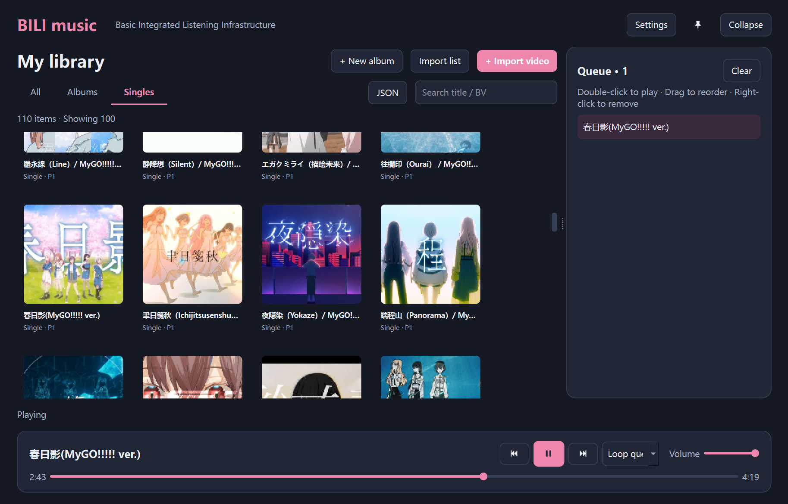
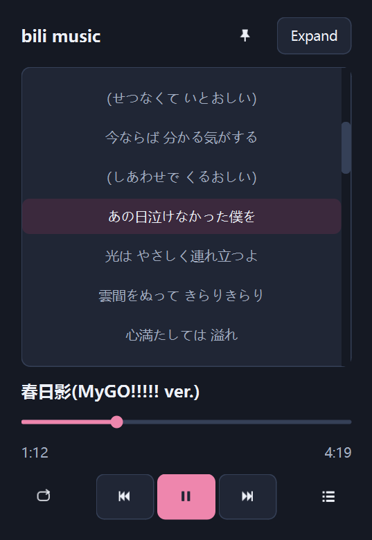

# BILI: Basic Integrated Listening Infrastructure (Bilibili/Youtube Music Player)



## Setup and run

Windows:

```bat
scripts\setup.bat
scripts\run.bat
scripts\deploy.bat
```

Linux / macOS:

```bash
bash scripts/setup.sh
bash scripts/run.sh
bash scripts/deploy.sh
```

## To-do

- Support multiple sources (local files)
- Add music downloads

## Usage

- Import music or albums from Bilibili using a BV ID or playlist.

- Import music from Youtube

- Search lyrics from LRCLIB

- Import/Export as JSON

- Mini music player

  
