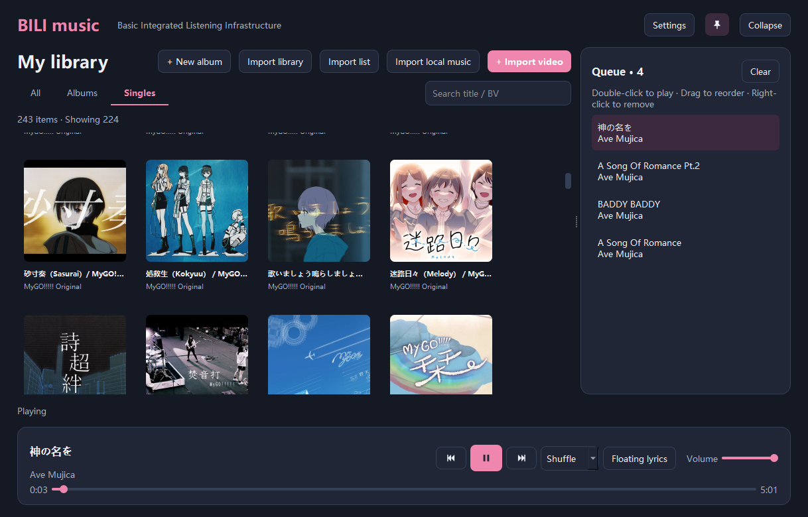
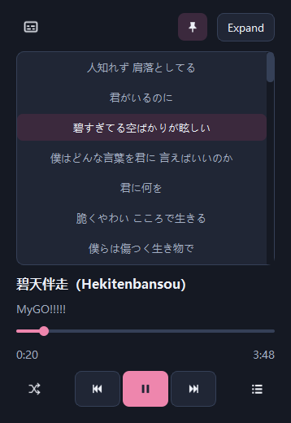

# BILI: Basic Integrated Listening Infrastructure (Bilibili/Youtube Music Player)



## Setup and run

Windows:

```bat
scripts\setup.bat
scripts\run.bat
scripts\deploy.bat
```

Linux / macOS:

```bash
bash scripts/setup.sh
bash scripts/run.sh
bash scripts/deploy.sh
```

## Usage

- Import tracks or albums from Bilibili using a BV ID or a playlist.

- Import tracks from YouTube and look up lyrics on LRCLIB.
- Import music files from your device.
- Download music to your device.
- Switch to the mini player to save screen space.

  

